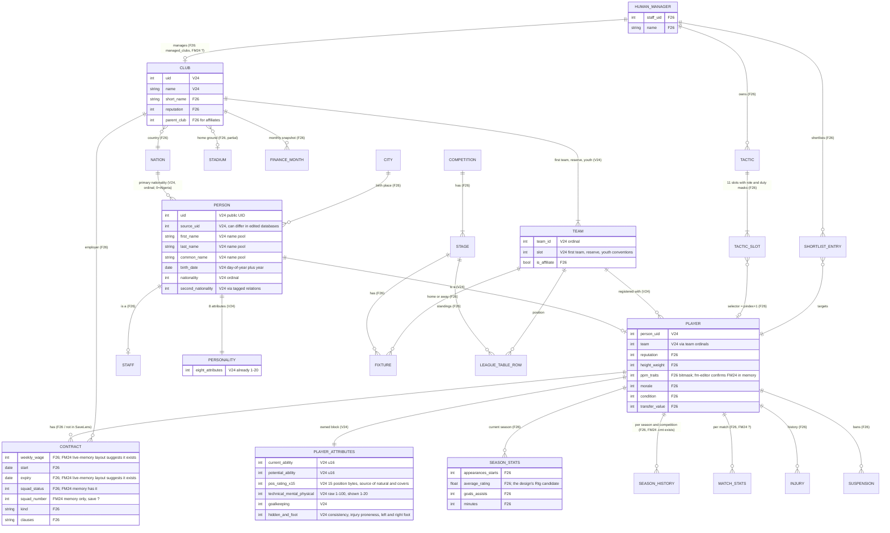

# FM24 save: available data and ERD

> **Working log.** This file is the chronological record of the research session (what was tried, in order, including dead ends and corrections). For reference use the structured documents [`docs/README.md`](../README.md) and 02 to 08. Where this log and those documents disagree, the structured documents are right.

Date: 2026-11-03. Research only. This is a **map of what the save is believed to contain**, not a finished schema.

## How much to trust this

| Tag | Meaning |
|---|---|
| **V24** | Verified for FM24 by FM SaveLens 24's documentation (validated on 61 FM24 saves against FMRTE exports and screenshots). |
| **F26** | Documented for **FM26** by fmsave / fm-toolkit. Probably exists in FM24, **layout not verified**. |
| **SAVE** | Seen directly in our sample save (member exists), but its records are not decoded yet. |
| **?** | No evidence either way. |

Nothing in the **F26** or **?** rows should be treated as available until decoded from an FM24 file. That includes wage and contract expiry.

## 1. Where data lives in the sample save (SAVE)

The sample has 750 top-level members plus 1,640 in the `rgman` sub-archive. The relevant ones:

| Member (plain size) | Likely content | Basis |
|---|---|---|
| `game_db.dat` (492 MB) | Main relational dump: persons, players, staff, clubs, teams, contracts, competitions, stages, tables | F26 docs. SaveLens reads persons, attributes and clubs from it (V24) |
| `humans.dat`, `manager_manager.dat` | Human managers; probably which club is managed | F26 (Gilet) |
| `contract_man.dat` | Contract offers and negotiation events, **not** the contract table itself | F26 (fm-toolkit) |
| `tactics_man.dat`, `team_talk_man.dat`, `captain_system.dat` | Tactics, lineups, selectors | F26 |
| `shortlist_man.dat`, `scout_man.dat`, `transfer_man.dat` | Shortlist, scouting, transfers | F26 |
| `pl_hist_dt.cmt` (+ `pl_hist_ls/id`), `player_stats_hist_dt.cmt` | Per-season player statistics history | F26 names it `.dat` there; in FM24 it is `.cmt` (SAVE) |
| `injury_manager.dat`, `injury_histories_*` | Injuries | F26 |
| `finance_manager.dat`, `financial_fair_play_manager.dat` | Club finances | F26 |
| `training_man.dat`, `training_camp_man.dat` | Training | F26 |
| `news.dat`, `press_conference_manager.dat`, `interaction_manager.dat`, `morale_manager.dat` | News, media, player promises and happiness | F26 |
| `game_info.dat` | Version `24.3.0+0` and list of applied patches | SAVE (read) |
| `save_game_summary.dat` | Build `24.4.2`, competition names, save summary | SAVE (read) |
| `*.apm`, `*.scm` (about 670 files) | Per-match data (names `<id>_<id>[_<n>]`) | ? |

Note one FM24 versus FM26 difference already visible: FM26 docs list `.cmt` as localized *commentary*, but FM24's `.cmt` members are history tables (`*_dt.cmt`). So FM26 member lists cannot be applied blindly.

## 1b. Confirmed on the sample save

Running the FM24 reference parser on the sample (see `fm24-save-files.md` section 11) confirmed the **V24** rows end to end: 222,391 players, 50,801 clubs, 115,941 teams, in-game date 2025-04-06, and a plausible 36-player Aberdeen squad with the expected CA/PA. Contracts, season stats and the managed club remain undecoded.

## 2. Entity-relationship diagram

Attributes named in comments carry the tags above. Entities with `?` fields are placeholders for what the design needs.

## 3. What the design needs, mapped to this model

| Design field | Entity.field | Status |
|---|---|---|
| Name | PERSON names | V24 |
| Age | PERSON.birth_date + game date (`game_db.dat` offsets 36 and 38) | V24 |
| Natural positions | PLAYER_ATTRIBUTES.pos_rating_x15 (rating 20 means natural, by convention; **not yet verified**) | V24 data, interpretation ? |
| "Covers" positions | same 15 ratings, intermediate values | V24 data, interpretation ? |
| Wage per week | CONTRACT.weekly_wage | **Decoded for FM24 (19/19 Aberdeen players): GBP per week `u32` at tag+17; displayed value = stored × currency rate × 52.** See `fm24-save-files.md` section 12 |
| Contract expiry | CONTRACT.expiry | **Decoded for FM24 (19/19 Aberdeen players): date at tag-9-29k, current contract = latest start on or before the game date.** Other clubs and youth contracts unverified. See section 12 |
| Rating (Rtg) | SEASON_STATS.average_rating, or CA | F26 / V24 |
| Which squad is mine | HUMAN_MANAGER → CLUB | F26; FM24 ? |
| Current squad | PLAYER.team → CLUB | V24 |
| Canteranos (home-grown or academy) | PLAYER relations `(1,72)` Home-Grown Club in the person block | F26 only |
| Tactic / lineup import (not in the design yet) | TACTIC, TACTIC_SLOT | F26 |
| Squad number | CONTRACT | **Decoded for FM24 (u8 at tag-12, 255 = none; 20/20 verified).** |
| Squad status | CONTRACT | ? (needs a contract screenshot) |
| Current XI, subs, squad plan | `tactics_man.dat` entries 0-25 (player entity ids) | **Decoded for FM24 (exact on Aberdeen's screen).** Role/duty bytes: candidate only |

## 4. Next verification steps for this model (research only)

1. Locate the human manager and managed club in the sample (`manager_manager.dat`, `humans.dat`). Expected: Theo Walcott / Aberdeen. This is the cheapest check and anchors everything else.
2. Find Aberdeen players in `game_db.dat` using SaveLens's documented name pools and attribute blocks as the starting point.
3. Locate contract records. Known real values from the user's game (three or four Aberdeen players' wage and expiry) allow searching for `i32` wage and date patterns near the person or team references. The FM24 live-memory layout (wage i32 at +0x18, expiry at +0x40 from a contract object) guides the shape of the record.
4. Check the 15 position bytes against the in-game position familiarity of known players to settle how "natural" and "covers" can be derived.
5. Find average rating in `player_stats_hist_dt.cmt` or `pl_hist_dt.cmt`.

## Sources

`docs/research/fm24-save-files.md` section 10 (members of the sample save); fm-toolkit `FM26_SAVE_DATABASE_SCHEMA_AND_81_SECTIONS.md` (28 FM26 tables); FM SaveLens 24 `docs/FORMAT.md` and `docs/VALIDATION.md`; fm-editor `docs/fm24/memory-layout.md`.
